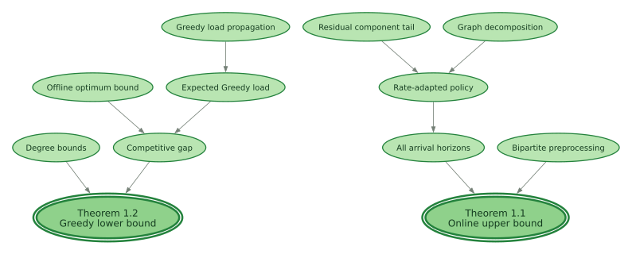

# Online Graph Balancing and the Power of Two Choices

The two main theorems—**Theorems 1.1 and 1.2**—are formalized in Lean.

[Paper](https://arxiv.org/abs/2604.04159v1) by Nikhil Bansal, Milind Prabhu,
Sahil Singla, and Siddharth M. Sundaram.

## Explore the proof

Open the [interactive proof graph](https://milind-prabhu.github.io/power-of-two-choices-general-graphs-lean/).
Click a theorem or lemma to see its Lean statement, proof, and dependencies.

[](https://milind-prabhu.github.io/power-of-two-choices-general-graphs-lean/)

## Build and verify

Install [elan](https://github.com/leanprover/elan), clone this repository, and run:

```bash
bash bootstrap.sh
bash check.sh
```

Lean **4.24.0** and mathlib are pinned. The check builds the proofs and runs
the axiom audit. [Build status](https://github.com/milind-prabhu/power-of-two-choices-general-graphs-lean/actions/workflows/lean.yml).

See the [formalization notes](FORMALIZATION.md) for theorem statements, assumptions,
and scope.

This formalization was achieved using **ChatGPT-6 Astra**.
